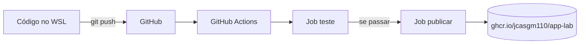
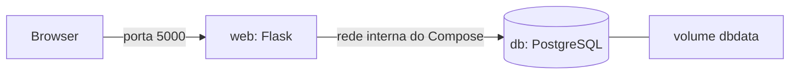

# devops-lab


Laboratório onde aprendo DevOps do zero: uma app web pequena, empacotada em Docker, com base de dados, testada e publicada automaticamente a cada `push`.

## O que faz

- App Flask que conta visitas e guarda-as numa base de dados PostgreSQL.
- Tudo corre em contentores com Docker Compose.
- Uma pipeline de CI/CD no GitHub Actions testa a app e publica a imagem no GitHub Container Registry.

## Arquitetura





## Como correr

```bash
git clone https://github.com/Jcasgm110/Devops-lab.git
cd Devops-lab
cp .env.example .env     # edita o .env e escolhe uma password
docker compose up --build
```

Abre `http://localhost:5000`. Cada visita aumenta o contador, e o valor sobrevive a `docker compose down`. Para apagar também os dados: `docker compose down -v`.

## O que a pipeline faz

1. Corre o script bash.
2. Constrói e corre as imagens Docker.
3. Levanta a app e a base de dados com Compose e testa a app com `curl`.
4. Se tudo passar, publica a imagem no `ghcr.io`.
5. Se algo falhar, mostra os logs dos contentores.

## Decisões
## Decisões

- **Segredos:** a password está num `.env` que não vai para o Git. O `.env.example` mostra só o formato.
- **PostgreSQL:** escolhi-o por ser gratuito e muito usado em produção, e porque, ao correr como serviço separado, me obriga a praticar um setup mais realista (vários contentores, volume, `healthcheck`). Para um simples contador bastava SQLite, mas não praticaria tanto.
- **Volume `dbdata`:** os dados ficam fora do contentor e sobrevivem a `docker compose down`.
- **`healthcheck` + `depends_on`:** a app só arranca depois de a base de dados aceitar ligações.
- **Testes no CI com Compose:** o CI levanta a app e a base de dados juntas, tal como corre no meu PC, em vez de testar a app sozinha.

## Problemas que resolvi e o que aprendi

- **O CI falhava** com o erro 56 do `curl`
O passo do CI falhou com o erro 56 do `curl`. O `curl` fez o pedido antes de a app Flask ter acabado de arrancar, e a ligação foi cortada. A app e a base de dados estavam bem, o problema era só de tempo. Resolvi com `--retry 15 --retry-delay 2 --retry-all-errors`: o `curl` tenta até 15 vezes, com 2 segundos entre cada, e repete mesmo quando a ligação é cortada, dando tempo ao Flask para arrancar. Acrescentei também um passo que mostra os logs quando algo falha.

- **Teste verde que não testou nada** 
Ao estragar o `Dockerfile` de propósito para ver o CI falhar, a pipeline ficou verde. Percebi com `git show` que o commit tinha criado um ficheiro novo, `dockerfile` (minúsculas), com os comandos escritos lá dentro em vez de os correr no terminal. O Linux distingue maiúsculas de minúsculas, por isso o `Dockerfile` verdadeiro nunca foi alterado. Apaguei o ficheiro a mais com `git rm` e repeti o teste, que desta vez falhou como devia. Aprendi a confirmar com `git show` ou `git diff` que um teste mexeu mesmo no que eu julgava.


## Próximos passos

- Servidor online (VPS) com HTTPS e deploy automático.
- Terraform e Ansible.
- Monitorização.